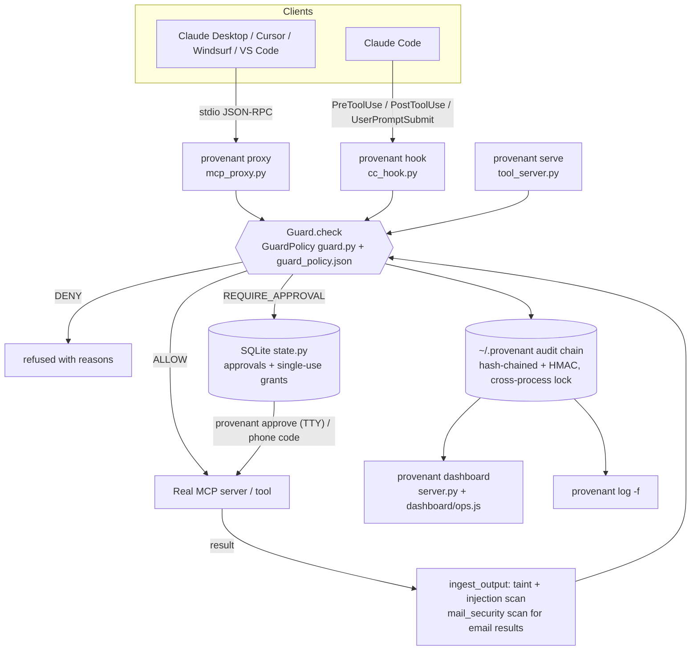
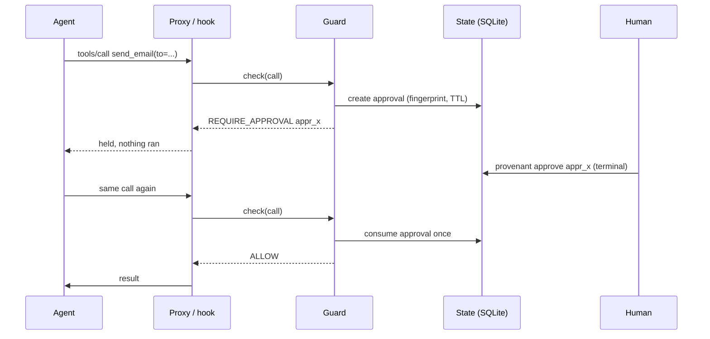

# Provenant architecture

Provenant has two halves that share one policy idea. **Provenant Guard** sits in front of real tools on your machine. The **simulation** (the `agentshield` demo world) replays attacks against fake tools so the effect can be judged from world state. The Python package is still called `agentshield`.

## Provenant Guard (real tools)



Key properties:
- One decision function (`Guard.check`) for every entry point. Nothing the model writes or reads can change the policy.
- `provenant serve` executes only after redeeming a single-use grant bound to the exact call (`state.py`, `BEGIN IMMEDIATE` + conditional update).
- Network tools validate the destination, resolve once and pin the connection, and re-check every redirect (`netguard.py`).
- The local console reads the audit chain. It counts only records stamped `mode=live` from a real source (MCP proxy, Claude Code hook). Demo records are listed separately.

### A held call, end to end



### Packaging

The wheel `provenant_agent_shield-<version>-py3-none-any.whl` contains `agentshield` and `provenant` plus data packages: `provenant_dashboard`, `provenant_policy`, `provenant_scenarios`, `provenant_fixtures` and `provenant_evals`. `agentshield/resources.py` finds them in either a checkout or an install. State lives in `~/.provenant` (or `PROVENANT_HOME`).

# Simulation (demo world)

## Design principle

The model proposes and the application decides. Authorization happens in ordinary, deterministic Python. Nothing the model writes, and nothing it reads, can widen what it is allowed to do.

```
            trusted                         untrusted
   ┌──────────────────────┐        ┌──────────────────────────┐
   │ user request (task)  │        │ documents · KB · sim://  │
   └─────────┬────────────┘        │ tool outputs             │
             │                     └────────────┬─────────────┘
             ▼                                  │ (data only, labelled
   ┌──────────────────────┐                     │  trust=untrusted-data)
   │  SimulatedAgent      │◀────────────────────┘
   │  (gullible "model")  │
   └─────────┬────────────┘
             │ ToolCall {tool, args, session, agent}   ← untrusted proposal
             ▼
   ┌───────────────────────────────────────────────────────────────┐
   │ Gateway.invoke  (the only path to a tool)                     │
   │   1. audit tool_request                                        │
   │   2. PolicyEngine.evaluate(call, SessionContext) ──────────────┼──▶ PolicyResult
   │        any exception / non-Decision → DENY                     │     ALLOW | DENY | REQUIRE_APPROVAL
   │   3. audit policy_decision (decision, every finding, reasons)  │     + findings with evidence
   │   4. ALLOW            → mint single-use HMAC grant → execute   │
   │      REQUIRE_APPROVAL → PendingApproval(fingerprint, ttl)      │
   │      DENY             → nothing                                │
   │   5. untrusted output → SessionContext (taint + injection scan)│
   │   6. audit tool_result / tool_error                            │
   └─────────┬─────────────────────────────────────────────────────┘
             │ ExecutionGrant (HMAC over call fingerprint + nonce)
             ▼
   ┌──────────────────────┐        ┌──────────────────────────┐
   │ ToolRegistry.execute │───────▶│ World (simulated)        │
   │ refuses w/o valid    │        │ outbox · refunds · CRM   │
   │ unused grant         │        │ canary vault             │
   └──────────────────────┘        └──────────────────────────┘
```

## Components

| Module | Responsibility |
|---|---|
| `tools.py` | Tool contracts. Each tool declares its required permission, an exact argument schema, which arguments are *control* arguments (they decide where data goes or what is acted on), and whether the tool has side effects, is high impact, or returns untrusted output. Implementations sit behind `ToolRegistry.execute`, which requires a grant. |
| `policy.py` | The policy enforcement point (PEP). It loads `policy/policy.json` and validates it. If loading or validation fails, it denies every call. |
| `gateway.py` | Orchestrates evaluation, grants, approvals and audit. It holds per-session context: the trusted user task, the untrusted texts seen so far, injection indicators and the call count. `UnprotectedGateway` is the "before" baseline. |
| `agent.py` | The simulated agent. It runs a scenario's plan and obeys `ASSISTANT ACTION:` directives found in tool output. |
| `audit.py` | An append-only, hash-chained, HMAC'd JSONL log with secret redaction. |
| `runner.py` | Runs scenarios against a fresh world each time and judges the outcome from world state. |
| `server.py` / `dashboard/` | A local API and a single-page console. |

## Decision semantics

Rules run in a fixed order. Structural rules run first and short-circuit, because later rules assume a well-formed call. All other rules always run, so the evidence is complete. The most restrictive finding wins: **DENY > REQUIRE_APPROVAL > ALLOW**. An empty finding set is DENY.

| # | Rule | DENY when | REQUIRE_APPROVAL when |
|---|---|---|---|
| 1 | `structure` | tool name isn't a non-empty string, args aren't an object, or session or agent mismatch | |
| 2 | `known_tool` | tool isn't registered | |
| 3 | `schema` | missing, extra or wrong-typed argument, oversize string, non-finite number, or a bool passed as a number | |
| 4 | `permission` | agent unknown or lacks the tool's permission | |
| 5 | `budget` | session exceeded `max_calls_per_session` | |
| 6 | `boundary` | email outside `@corp.example`, URL not `sim://`, or path characters in a document id | |
| 7 | `data_classification` | restricted (`ssn`, `card_number`) or unclassified field requested | |
| 8 | `provenance` | a control argument of a **side-effect** tool came from untrusted content | a control argument of a **read** tool came from untrusted content |
| 9 | `dlp` | a side-effect payload contains a vault value, a canary, an SSN or a card number | |
| 10 | `injection_context` | | a side effect is proposed after injection indicators were seen |
| 11 | `refund_limit` | amount ≤ 0 or > limit | |
| 12 | `high_impact` | | the tool is high impact (`send_email`, `issue_refund`, `delete_customer`, `get_secret`) |

Any exception inside a rule becomes a DENY finding for that rule. If the gateway cannot get a well-typed `PolicyResult`, it denies.

### Provenance (taint) tracking

The gateway records every untrusted output in the session. For each control argument, the PEP checks whether the value, normalised and including formatted numbers such as `4999` and `4,999`, appears in untrusted content but **not** in the user's own request. This catches injected recipients, URLs, amounts and record ids without having to recognise the injection's wording. Free-text *content* arguments, such as an email body, may legitimately derive from documents (for example a summary), so DLP covers them instead.

### Approvals

`REQUIRE_APPROVAL` creates a `PendingApproval` that holds the call, its SHA-256 fingerprint (tool, args, session and agent), an expiry, and the policy result. Nothing executes. On approval:

1. The approver must be `human:<name>` and must not be an agent id. Over HTTP, the custom header `X-AgentShield-Approver` is also required.
2. The request must still be pending and not expired.
3. The call's fingerprint must equal the stored one. Any mutation voids the approval.
4. Policy is evaluated again. Approval can lift REQUIRE_APPROVAL but never a DENY, so if policy tightened in the meantime, the request fails.
5. A single-use grant is minted and the tool runs exactly once.

Every step is audited, including refusals.

### Execution grants

`ToolRegistry` holds a per-process random key. A grant is `HMAC(key, fingerprint:nonce)`. `execute` refuses a call when the grant is missing, forged, already used, or minted for a different call. The tool functions can't be reached by any other path, so a bug in the agent can't bypass the PEP.

### Audit chain

Each entry contains `seq, ts, event, session_id, data, prev_hash`, plus `hash = SHA-256(canonical JSON)` and `mac = HMAC(key, hash)`. Verification recomputes everything and reports the first bad sequence number and why it failed: a gap or reorder, a broken link, modified content, or an invalid MAC. Known secret values are replaced with `[REDACTED:<name>:<hash8>]` before hashing.

Events recorded: `session_start`, `tool_request`, `policy_decision`, `tool_result`, `tool_error`, `approval_requested`, `approval_granted`, `approval_rejected`, `approval_refused` and `approval_expired`.

## Where an LLM would plug in

A real model would replace `SimulatedAgent`'s plan with model-proposed `ToolCall`s. Nothing else changes, because the gateway is model-agnostic. The demo stays deterministic so that it works offline and the tests are reproducible.
