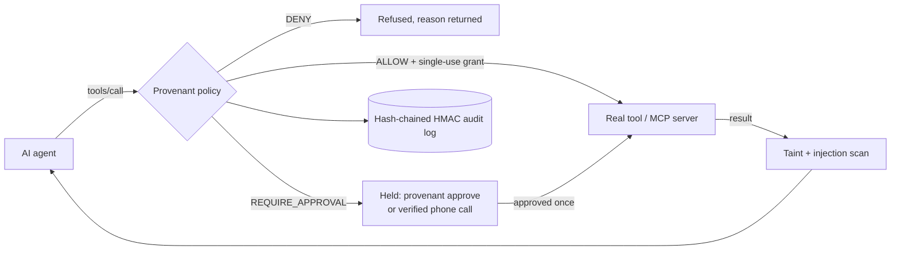

# Security model

This document states what Provenant protects, how, and where it stops. The threat-by-threat list is in [THREAT_MODEL.md](THREAT_MODEL.md); the measured results are in [eval/REPORT.md](eval/REPORT.md).

## The one rule

**The model is never the security boundary.** Provenant assumes the agent is fully gullible: it will try anything a prompt, a document, an email or a tool result tells it to. Every tool call the agent proposes passes through one deterministic policy decision point written in plain Python. The decision is one of:

| Decision | Meaning |
|---|---|
| `ALLOW` | The call runs. On the gated tool server it runs under a single-use grant bound to that exact call. |
| `DENY` | The call never reaches the tool. The reason is shown to the agent and recorded. |
| `REQUIRE_APPROVAL` | The call is held. Only a person typing at a terminal (`provenant approve`) or answering a verified phone call can release it, once. |

No findings means `DENY` (fail closed). A policy file that fails to load means the built-in policy is used, and a missing built-in means `DENY`.

## What the policy looks at

- **The call itself**: tool name, arguments, shell command structure (recursive deletes, pipes to a shell, encoded payloads, publishing, cloud and database destruction), paths (workspace escape, credential files), network destinations (private, link-local and metadata IPs in decimal, hex, octal and IPv6-mapped forms; redirects are re-validated; connections are pinned to the address that was checked).
- **Provenance**: values the agent read from untrusted content (web pages, emails, MCP tool results) are tracked. A send or write whose destination came from that content, not from the user, is denied.
- **Injection context**: once a session has read content containing prompt-injection indicators (after decoding base64, hex, zero-width, tag characters and homoglyphs), every later side effect in that session needs a human.
- **Data loss**: secrets, keys and regulated identifiers in outgoing arguments.

## Where enforcement happens

- **MCP proxy** (`provenant proxy`, installed by `provenant setup`): sits on the stdio pipe. Only allowed `tools/call` requests reach the server, including requests shaped like notifications. Tool manifests are pinned by HMAC; a changed definition (rug pull) is withheld until re-approved.
- **Claude Code hook** (`provenant hook`): PreToolUse returns deny or ask; PostToolUse ingests results for taint; UserPromptSubmit records what the user actually asked for.
- **Gated tool server** (`provenant serve`): check, then redeem the grant, then execute. A grant cannot be replayed or used for different arguments.

## Human approval

- Approvals are bound to a fingerprint of the exact call and expire.
- `provenant approve` refuses to run without a terminal, so an agent cannot approve its own call by running the command. This is a speed bump, not a proof: an agent with a real PTY could still type. The dashboard never approves anything.
- Phone approval (`voice.py`) checks the transcript deterministically: an approval word plus a 4-digit HMAC code read to the person. Only `Guard.decide(channel="phone")` changes state. **It has not yet been tested with a real call.**

## The advisory model

`classifier.py` is optional and off by default. It can only escalate (ALLOW to REQUIRE_APPROVAL); it can never allow, deny less, or bypass an approval. No model is trained or shipped.

## Audit

Every request, decision, approval and result goes into an append-only, hash-chained, HMAC-signed log in `~/.provenant`, shared across processes with a lock. `provenant audit verify` reports the first bad sequence number. The log is tamper-evident, not tamper-proof: deleting the tail leaves a valid shorter chain, so anchor the head externally with `provenant audit checkpoint`.

## Secrets and privacy

- No secrets in the repository; test fixtures use reserved fake values (`{{fake:NAME}}`, 900-area SSNs, `.example` domains).
- The Bolna API key is stored in `~/.provenant/mail.json` with mode 0600, and encrypted with Windows DPAPI on Windows. Provenant never writes it to the registry.
- The feed and dashboard mask secrets and phone numbers. Phone alerts never read links or message bodies aloud.
- The local dashboard binds to 127.0.0.1, checks the Host header, and serves a fixed allow-list of files under a self-only Content Security Policy.

## Known limits (stated in the demo)

- Shell analysis is pattern-based. An agent that writes a script and then runs it is judged on the run command, and writing the script is a held side effect only if other rules fire.
- Provenance is value-based. A paraphrased or transformed destination can evade the provenance rule; the other rules still apply.
- Remote (HTTP) MCP servers are not proxied yet; only stdio servers.
- Phone approval and the Windows one-line installer have not run against real infrastructure. CI workflows exist but have not run on GitHub.
- Passing 225 attack cases is evidence of coverage for those cases, not proof that no bypass exists.
